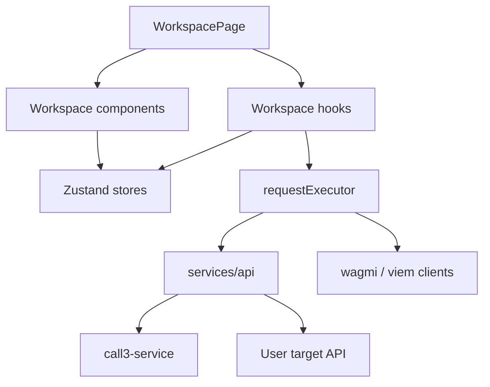

# Workspace Architecture

The workspace follows the repository feature-based architecture. Product behavior is organized around the workspace capability, while shared side effects and durable state live in services and stores.

## High-level flow

## Page ownership

`WorkspacePage.tsx` owns only top-level wiring:

- starts global workspace hooks such as auto-collapse and unsaved-change warning;
- reads collections, tabs, active tab id, drafts, and sidebar state from `useWorkspaceStore`;
- initializes a draft when an existing request tab becomes active;
- computes the active request from draft first, saved collection second;
- computes dirty state by comparing active draft to the saved request;
- starts ABI auto-load for the active contract request;
- creates the public client for the selected network;
- gets request execution handlers from `useRequestRunner`;
- renders the sidebar, tab header, active request workspace, dialogs, and empty state.

Do not add parsing, network calls, wallet operations, or large nested UI blocks to this file. Move those into hooks, utilities, services, or child components.

## Component ownership

`src/features/workspace/components/collection/` owns collection sidebar UI:

- collection list rendering;
- collection/request context menus;
- import/export buttons;
- collection dialogs;
- sidebar header.

`src/features/workspace/components/request/` owns active request UI:

- request name, method, target, selected network/RPC, save/send actions;
- settings panel selection for REST versus contract request types;
- response pane and response payload rendering;
- tab header and tab context menu;
- workspace dialogs such as ABI, RPC, and save-response dialogs.

`src/features/workspace/components/environment/` owns environment UI:

- environment selector;
- environment management dialog;
- variable table;
- pincode and unlock panels;
- environment-aware input/textarea overlays.

## Hook ownership

Workspace hooks contain stateful behavior that is still feature-specific:

- `useRequestRunner`: main send/save/simulate orchestration, environment resolution, sensitive unlock gate, and error redaction.
- `useRunRestRequest`: REST execution result handling and response updates.
- `useRunContractRequest`: READ, WRITE, SEND, wallet connection, network switching, simulation, and contract response updates.
- `useAutoLoadAbi`: contract address/network watcher and Call3 contract-info lookup.
- `useWorkspacePublicClient`: public client selection for the active network/RPC.
- `useAutoCollapseSidebar`: responsive sidebar behavior.
- `useUnsavedChangesWarning`: browser navigation guard for unsaved drafts.

## Utility ownership

Workspace utilities must be deterministic and independent of React:

- `requestImport.ts`: parse pasted URL, cURL, and fetch commands.
- `collectionTransfer.ts`: parse/export Call3 collections and import Postman collections.
- `postmanCollectionImport.ts`: convert Postman v2.1-style collections into Call3 requests.
- `contractAbi.ts`: parse JSON and human-readable ABI inputs.
- `contractArgs.ts`: format string form values into ABI argument values.
- `environment.ts`: resolve and redact environment variables.
- `sensitiveCrypto.ts`: derive keys and encrypt/decrypt sensitive values.
- `responsePayload.ts`: prepare response payloads for display.
- `requestDirty.ts`: compare draft and saved request state.
- `rpcOptions.ts`: combine built-in and custom RPC options.

## Service ownership

Services are where side effects belong:

- `src/services/requestExecutor.ts` wraps viem/wagmi execution helpers and delegates REST to API services.
- `src/services/api/restApi.ts` converts workspace REST fields into an API request.
- `src/services/api/httpClient.ts` owns direct fetch, response parsing, CORS proxy fallback, and sensitive proxy confirmation.
- `src/services/api/contractExplorerApi.ts` calls Call3 `contract-info`.
- `src/services/api/bytecodeAbiApi.ts` calls Call3 `decode-abi`.

## Store ownership

Stores are durable application state:

- `useWorkspaceStore`: collections, tabs, drafts, sidebar state, dialog state, ABI loading state, and response save/delete actions.
- `useEnvironmentStore`: environments, active environment, sensitive pincode config, lock/unlock state, and encrypted sensitive values.
- `useRpcStore`: custom RPC endpoints and manage-RPC dialog state.
- `useAbiStore`: saved ABI library and manage-ABI dialog state.
- `useCorsStore`: origins known to need proxy fallback.
